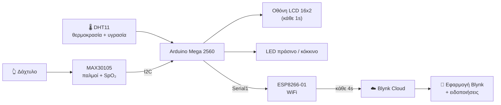

<h1 align="center">Smart Health Monitor</h1>

  <b>Σύστημα βιομετρικής παρακολούθησης μέσω IoT με Arduino Mega, ESP8266 και Blynk</b>

  
  
  
  
  

Ένας **Arduino Mega 2560** μετρά **καρδιακούς παλμούς και κορεσμό οξυγόνου** με τον αισθητήρα MAX30105, καθώς και
**θερμοκρασία και υγρασία** περιβάλλοντος με τον DHT11. Οι τιμές εμφανίζονται σε **οθόνη LCD**, ένα **φανάρι LED**
δείχνει αν είναι φυσιολογικές, και μέσω **ESP8266** στέλνονται στο **Blynk Cloud** για απομακρυσμένη παρακολούθηση από
το κινητό, με **ειδοποίηση** όταν βγουν εκτός ορίων.

Έρλα Γκικούλη (ΑΜ 2020/047), Διεθνές Πανεπιστήμιο της Ελλάδος, Δεκέμβριος 2025.

> [!NOTE]
> Εκπαιδευτικό project. Δεν είναι ιατρική συσκευή και οι μετρήσεις του δεν έχουν επικυρωθεί κλινικά.

---

## Σκοπός

Συνεχής παρακολούθηση τριών κατηγοριών δεδομένων, **τοπικά και από απόσταση**:

| | Μέγεθος | Πώς μετριέται |
|---|---|---|
| 💓 | **Καρδιακοί παλμοί (BPM)** | φωτοπληθυσμογραφία (PPG) με τον MAX30105 |
| 🩸 | **Κορεσμός οξυγόνου (SpO₂)** | σύγκριση κόκκινου και υπέρυθρου φωτός |
| 🌡️ | **Περιβάλλον** | θερμοκρασία και σχετική υγρασία με τον DHT11 |

Η συσκευή λειτουργεί και **αυτόνομα χωρίς WiFi** (οθόνη και LED). Με σύνδεση, τα δεδομένα φτάνουν στο κινητό μέσω Blynk.

---

## Πώς λειτουργεί

| Τι δείχνει | Πού | Κάθε πότε |
|---|---|---|
| Παλμοί (BPM) και οξυγόνο (SpO₂) | LCD γραμμή 1, Blynk `V0`, `V1` | 1s (LCD), 4s (Blynk) |
| Θερμοκρασία και υγρασία | LCD γραμμή 2, Blynk `V2`, `V3` | 1s (LCD), 4s (Blynk) |
| 🟢 Πράσινο LED | τιμές φυσιολογικές: 50–110 BPM και SpO₂ ≥ 90% | συνεχώς |
| 🔴 Κόκκινο LED | χωρίς δάχτυλο ή τιμές εκτός ορίων | συνεχώς |
| 🔔 Ειδοποίηση `health_alert` | BPM > 110 ή SpO₂ < 90% | στην αποστολή στο Blynk |

---

## Γιατί Arduino Mega 2560

| Χαρακτηριστικό | Γιατί χρειάζεται εδώ |
|---|---|
| **4 σειριακές θύρες (UART)** | Η `Serial1` (pins 18, 19) είναι αφιερωμένη στο ESP8266, ενώ η `Serial0` μένει ελεύθερη για debugging μέσω USB. |
| **256 KB μνήμη Flash** | Χωράνε μαζί οι βιβλιοθήκες Blynk, MAX30105, DHT, LCD και ESP8266. Ο κώδικας πιάνει μόλις το 11%. |
| **54 ψηφιακά και 16 αναλογικά pins** | Όλα τα περιφερειακά συνδέονται απευθείας, χωρίς multiplexers. |
| **Σταθερή τροφοδοσία 5 V** | Για σταθερές μετρήσεις από τον αισθητήρα, την οθόνη και τον DHT11. |

---

## Μέτρηση παλμών και οξυγόνου

Ο αισθητήρας ρίχνει **κόκκινο και υπέρυθρο φως** στο δάχτυλο και ένας φωτοανιχνευτής μετρά πόσο επιστρέφει. Σε κάθε
χτύπο της καρδιάς ο όγκος του αίματος αλλάζει λίγο, και μαζί του το φως που απορροφάται. Αυτή η ρυθμική αλλαγή δίνει
τους παλμούς.

Για το **οξυγόνο**: το αίμα με λίγο οξυγόνο απορροφά περισσότερο **κόκκινο** φως, ενώ το οξυγονωμένο απορροφά περισσότερο
**υπέρυθρο**. Συγκρίνοντας τις δύο μετρήσεις υπολογίζεται ο λόγος των λόγων:

$$R = \frac{AC_{red}/DC_{red}}{AC_{IR}/DC_{IR}} \qquad SpO_2 = 100 - 23{,}3\,(R - 0{,}4) + 5$$

όπου AC είναι το παλμικό μέρος του σήματος και DC η σταθερή βάση. Το +5 είναι εμπειρική διόρθωση. Η τιμή περιορίζεται
στο 80–100% και εξομαλύνεται εκθετικά (`ESpO2 = 0,7 × παλιά + 0,3 × νέα`), ώστε να μην «χοροπηδά» στην οθόνη.

**Παλμοί**: ο κάθε χτύπος ανιχνεύεται με το `checkForBeat()` της SparkFun και ο ρυθμός που εμφανίζεται είναι ο
**κυλιόμενος μέσος όρος των 6 τελευταίων χτύπων**, ώστε να είναι σταθερός. Αν το υπέρυθρο σήμα πέσει κάτω από
**7000**, η συσκευή θεωρεί ότι δεν υπάρχει δάχτυλο και εμφανίζει «Place Finger...».

### Τεχνικές βελτιώσεις

Η αρχική έκδοση έδινε λάθος τιμές (π.χ. **40 BPM αντί για 70–80**). Με πειραματισμό βρέθηκαν οι ρυθμίσεις:

| Ρύθμιση | Τιμή | Γιατί |
|---|---|---|
| **Ρυθμός δειγματοληψίας** | 400 Hz, χωρίς μέσο όρο δειγμάτων | Στα 100 Hz οι γρήγορες αλλαγές του σήματος χάνονταν και οι παλμοί μετριούνταν λιγότεροι. |
| **Εύρος ADC** | 16384 | Αποφεύγεται ο **κορεσμός**: όταν το σήμα «χτυπά» στο όριο, η κυματομορφή κόβεται και χάνονται παλμοί. |
| **Φωτεινότητα LED** | 0x1F (σταθερή) | Αρκετό φως για καθαρό σήμα, χωρίς να «τυφλώνεται» ο αισθητήρας. |
| **Όριο ανίχνευσης δαχτύλου** | 7000 | Προσδιορίστηκε πειραματικά για αυτές τις ρυθμίσεις φωτεινότητας και ADC. |

---

## Multitasking χωρίς `delay()`

Με `delay(1000)` το Arduino θα «πάγωνε» για ένα δευτερόλεπτο και, στα 400 Hz, θα έχανε **400 δείγματα**, άρα
ολόκληρους παλμούς. Γι' αυτό ο κώδικας δεν σταματά ποτέ: κάθε εργασία τρέχει όταν έρθει η ώρα της, με χρονισμό `millis()`.

| Εργασία | Κάθε πότε | Διάρκεια |
|---|---|---|
| Ανάγνωση MAX30105 και ανίχνευση παλμού | συνεχώς (κάθε δείγμα ≈ 2,5 ms) | ελάχιστη |
| Ανάγνωση DHT11 και ενημέρωση LCD και LED | 1 s | ≈ 50–100 ms |
| Αποστολή στο Blynk | 4 s | ≈ 200–500 ms, ανάλογα με το WiFi |

Το DHT11 χρειάζεται έτσι κι αλλιώς τουλάχιστον 1 δευτερόλεπτο ανάμεσα στις μετρήσεις, και η αποστολή ανά 4 δευτερόλεπτα
προστατεύει το ESP8266, που με πολλές εντολές σε λίγο χρόνο μπορεί να «κολλήσει». Οι μη έγκυρες αναγνώσεις του DHT11
απορρίπτονται με `isnan()`, ώστε να μην εμφανίζεται «NaN» στην οθόνη.

---

## Υλικό και συνδεσμολογία

| Εξάρτημα | Σύνδεση στο Arduino Mega |
|---|---|
| MAX30105 (παλμοί, SpO₂) | I2C: SDA → 20, SCL → 21 |
| Οθόνη LCD 16x2 με I2C (διεύθυνση `0x27`) | I2C: SDA → 20, SCL → 21 (μόνο 4 καλώδια αντί για 16) |
| DHT11 (θερμοκρασία, υγρασία) | Data → pin 7 |
| LED κόκκινο / πράσινο | pin 5 / pin 4 |
| ESP8266-01 (WiFi) | Serial1: TX1 (18), RX1 (19), 115200 baud, τροφοδοσία 3,3 V |

**DHT11**: θερμοκρασία 0–50 °C (±2 °C), υγρασία 20–90% (±5%), χρόνος απόκρισης περίπου 2 s.

---

## Εγκατάσταση

1. **Arduino IDE** με πλακέτα **Arduino Mega or Mega 2560**.
2. **Βιβλιοθήκες** (*Sketch → Include Library → Manage Libraries*):

   | Βιβλιοθήκη | Ρόλος |
   |---|---|
   | *Blynk* (Volodymyr Shymanskyy) | Σύνδεση με το Blynk: Virtual Pins, ειδοποιήσεις |
   | *BlynkESP8266_Lib* (παρέχει το `ESP8266_Lib.h`) | Έλεγχος του ESP8266 με AT commands |
   | *SparkFun MAX3010x Pulse and Proximity Sensor Library* | Ρύθμιση του αισθητήρα και ανίχνευση παλμού |
   | *DHT sensor library* (Adafruit) | Θερμοκρασία και υγρασία |
   | *LiquidCrystal I2C* (Frank de Brabander) | Οθόνη LCD μέσω I2C |

3. **Κωδικοί**: στον φάκελο `healthmonitor/`, αντιγράψτε το
   [`arduino_secrets.example.h`](healthmonitor/arduino_secrets.example.h) σε νέο αρχείο **`arduino_secrets.h`** και
   συμπληρώστε το Template ID και το Auth Token από το Blynk console, καθώς και το όνομα και τον κωδικό του WiFi.
   Το `arduino_secrets.h` **δεν ανεβαίνει ποτέ στο GitHub** (βλ. `.gitignore`).
4. Άνοιγμα του [`healthmonitor/healthmonitor.ino`](healthmonitor/healthmonitor.ino) και **Upload**.
5. Στο **Blynk**: Template με Virtual Pins `V0` (BPM), `V1` (SpO₂ %), `V2` (θερμοκρασία °C), `V3` (υγρασία %) και
   ένα Event με κωδικό `health_alert` για τις ειδοποιήσεις.

---

## Περιορισμοί και ιδέες

- Οι μετρήσεις **δεν έχουν συγκριθεί συστηματικά** με ιατρικό οξύμετρο. Το SpO₂ βασίζεται σε εμπειρικό τύπο.
- Ο DHT11 είναι οικονομικός αλλά με περιορισμένη ακρίβεια (±2 °C). Ο DHT22 θα ήταν πιο ακριβής.
- Η κίνηση του δαχτύλου αλλοιώνει τη μέτρηση: δεν υπάρχει ακόμα ανίχνευση κίνησης.
- Ιδέες: σύγκριση με εμπορικό οξύμετρο, ιστορικό μετρήσεων στο Blynk, μπαταρία και θήκη για φορητή χρήση.

---

## Δομή

| Αρχείο | Τι είναι |
|---|---|
| [`healthmonitor/healthmonitor.ino`](healthmonitor/healthmonitor.ino) | Ο κώδικας του Arduino |
| [`healthmonitor/arduino_secrets.example.h`](healthmonitor/arduino_secrets.example.h) | Υπόδειγμα για τους κωδικούς Blynk και WiFi |
