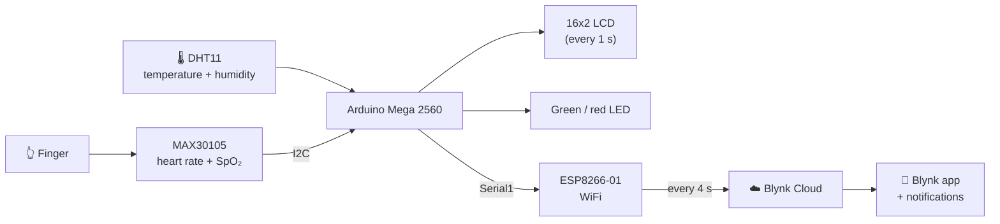

<h1 align="center">Smart Health Monitor</h1>

  <b>IoT biometric monitoring with Arduino Mega, ESP8266 and Blynk</b>

  
  
  
  
  

An **Arduino Mega 2560** measures **heart rate and blood oxygen** with the MAX30105 sensor, plus room **temperature and
humidity** with a DHT11. Values are shown on an **LCD**, a **traffic-light LED** shows whether they are normal, and an
**ESP8266** sends them to the **Blynk Cloud** for remote monitoring from a phone, with an **alert** when they go out of
range.

Erla Gkikouli, International Hellenic University, December 2025.

> [!NOTE]
> Educational project. It is not a medical device and its measurements have not been clinically validated.

---

## Purpose

Continuous monitoring of three kinds of data, **locally and remotely**:

| | Quantity | How it is measured |
|---|---|---|
| 💓 | **Heart rate (BPM)** | photoplethysmography (PPG) with the MAX30105 |
| 🩸 | **Blood oxygen (SpO₂)** | comparing red and infrared light |
| 🌡️ | **Environment** | temperature and relative humidity with the DHT11 |

The device also works **stand-alone without WiFi** (display and LEDs). With a connection, the data reach the phone
through Blynk.

---

## How it works

| What | Where | How often |
|---|---|---|
| Heart rate (BPM) and SpO₂ | LCD line 1, Blynk `V0`, `V1` | 1 s (LCD), 4 s (Blynk) |
| Temperature and humidity | LCD line 2, Blynk `V2`, `V3` | 1 s (LCD), 4 s (Blynk) |
| 🟢 Green LED | normal values: 50–110 BPM and SpO₂ ≥ 90% | continuously |
| 🔴 Red LED | no finger, or values out of range | continuously |
| 🔔 `health_alert` event | BPM > 110 or SpO₂ < 90% | on each Blynk upload |

---

## Why an Arduino Mega 2560

| Feature | Why it matters here |
|---|---|
| **4 hardware serial ports (UART)** | `Serial1` (pins 18, 19) is dedicated to the ESP8266, while `Serial0` stays free for USB debugging. |
| **256 KB Flash** | The Blynk, MAX30105, DHT, LCD and ESP8266 libraries fit together. The sketch uses only 11%. |
| **54 digital and 16 analog pins** | All peripherals connect directly, with no multiplexers. |
| **Stable 5 V supply** | Steady readings from the sensor, the display and the DHT11. |

---

## Measuring heart rate and blood oxygen

The sensor shines **red and infrared light** into the fingertip and a photodetector measures how much comes back. With
every heartbeat the blood volume changes slightly, and so does the absorbed light. This rhythmic change gives the
heart rate.

For **blood oxygen**: blood with little oxygen absorbs more **red** light, while oxygenated blood absorbs more
**infrared**. Comparing the two gives the ratio of ratios:

$$R = \frac{AC_{red}/DC_{red}}{AC_{IR}/DC_{IR}} \qquad SpO_2 = 100 - 23.3\,(R - 0.4) + 5$$

where AC is the pulsating part of the signal and DC the steady baseline. The +5 is an empirical correction. The value
is clamped to 80–100% and exponentially smoothed (`ESpO2 = 0.7 × old + 0.3 × new`) so that it does not jump around on
the display.

**Heart rate**: each beat is detected with SparkFun's `checkForBeat()`, and the displayed rate is the **moving average
of the last 6 beats**, which keeps it stable. If the infrared signal drops below **7000**, the device assumes there is
no finger and shows "Place Finger...".

### Tuning that fixed the readings

The first version gave wrong values (e.g. **40 BPM instead of 70–80**). Experimenting led to these settings:

| Setting | Value | Why |
|---|---|---|
| **Sample rate** | 400 Hz, no sample averaging | At 100 Hz the fast parts of the waveform were lost and beats were undercounted. |
| **ADC range** | 16384 | Avoids **saturation**: when the signal hits the ADC limit the waveform is clipped and beats are lost. |
| **LED brightness** | 0x1F (fixed) | Enough light for a clean signal without "blinding" the sensor. |
| **Finger threshold** | 7000 | Found experimentally for these brightness and ADC settings. |

---

## Multitasking without `delay()`

With `delay(1000)` the Arduino would freeze for one second and, at 400 Hz, miss **400 samples**, i.e. whole heartbeats.
So the loop never stops: every task runs when its time comes, timed with `millis()`.

| Task | How often | Duration |
|---|---|---|
| Read MAX30105 and detect beats | continuously (one sample ≈ 2.5 ms) | minimal |
| Read DHT11, update LCD and LEDs | 1 s | ≈ 50–100 ms |
| Upload to Blynk | 4 s | ≈ 200–500 ms, depending on WiFi |

The DHT11 needs at least 1 second between readings anyway, and uploading every 4 seconds protects the ESP8266, which
can hang if it receives too many commands in a short time. Invalid DHT11 readings are discarded with `isnan()`, so
"NaN" never appears on the display.

---

## Hardware and wiring

| Component | Arduino Mega connection |
|---|---|
| MAX30105 (heart rate, SpO₂) | I2C: SDA → 20, SCL → 21 |
| 16x2 LCD with I2C backpack (address `0x27`) | I2C: SDA → 20, SCL → 21 (4 wires instead of 16) |
| DHT11 (temperature, humidity) | Data → pin 7 |
| Red / green LED | pin 5 / pin 4 |
| ESP8266-01 (WiFi) | Serial1: TX1 (18), RX1 (19), 115200 baud, 3.3 V supply |

**DHT11**: temperature 0–50 °C (±2 °C), humidity 20–90% (±5%), response time about 2 s.

---

## Setup

1. **Arduino IDE** with the **Arduino Mega or Mega 2560** board.
2. **Libraries** (*Sketch → Include Library → Manage Libraries*):

   | Library | Role |
   |---|---|
   | *Blynk* (Volodymyr Shymanskyy) | Blynk connection: Virtual Pins, notifications |
   | *BlynkESP8266_Lib* (provides `ESP8266_Lib.h`) | Drives the ESP8266 with AT commands |
   | *SparkFun MAX3010x Pulse and Proximity Sensor Library* | Sensor configuration and beat detection |
   | *DHT sensor library* (Adafruit) | Temperature and humidity |
   | *LiquidCrystal I2C* (Frank de Brabander) | LCD over I2C |

3. **Credentials**: in the `healthmonitor/` folder, copy
   [`arduino_secrets.example.h`](healthmonitor/arduino_secrets.example.h) to a new file **`arduino_secrets.h`** and
   fill in the Template ID and Auth Token from the Blynk console, plus your WiFi name and password.
   `arduino_secrets.h` is **never committed to GitHub** (see `.gitignore`).
4. Open [`healthmonitor/healthmonitor.ino`](healthmonitor/healthmonitor.ino) and click **Upload**.
5. In **Blynk**: a template with Virtual Pins `V0` (BPM), `V1` (SpO₂ %), `V2` (temperature °C), `V3` (humidity %) and
   an Event with the code `health_alert` for notifications.

---

## Limitations and ideas

- The readings have **not been systematically compared** with a medical oximeter. SpO₂ uses an empirical formula.
- The DHT11 is cheap but of limited accuracy (±2 °C). A DHT22 would be more accurate.
- Finger movement distorts the measurement: there is no motion detection yet.
- Ideas: comparison with a commercial oximeter, measurement history in Blynk, battery and enclosure for portable use.

---

## Layout

| File | What it is |
|---|---|
| [`healthmonitor/healthmonitor.ino`](healthmonitor/healthmonitor.ino) | The Arduino sketch |
| [`healthmonitor/arduino_secrets.example.h`](healthmonitor/arduino_secrets.example.h) | Template for the Blynk and WiFi credentials |
